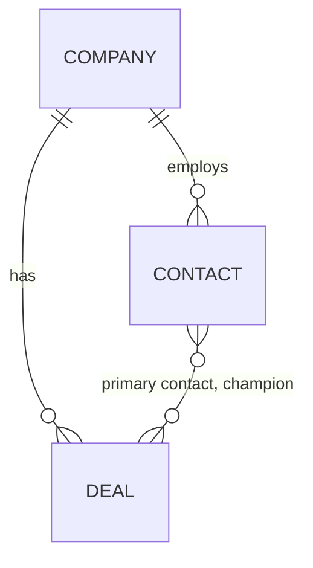

# CRM data model (Attio)

Three objects: Company, Contact, Deal. Attio holds decisions and conversations; the warehouse holds scores and evidence. Enrichment is two-stage: a cheap baseline for every company, a deep dive for the top 5 and for deals. Attio facts confirmed in its docs: `domains` is the company match key, Deals is an optional object that must be enabled, and the upsert is `PUT /v2/objects/{object}/records?matching_attribute=...` (one matching attribute per call; an error if more than one record matches).

## Company

| Attribute | Attio type | Source | Written by |
|---|---|---|---|
| `name` | text | crunchbase | machine |
| `domains` | domain | crunchbase / rb2b / form / human | machine |
| `crunchbase_uuid` | text | crunchbase | machine |
| `linkedin` | text | crunchbase / clay | machine |
| `hq_country` | text | crunchbase | machine |
| `hq_region` | select | crunchbase | machine |
| `industry` | select | tavily (verified) | machine |
| `segment` | select | warehouse score | machine |
| `tier` | select | warehouse score | machine |
| `fit_score` | number | warehouse score | machine |
| `score_funding_recency` | number | warehouse score | machine |
| `score_revenue` | number | warehouse score | machine |
| `score_headcount` | number | warehouse score | machine |
| `score_fit_bonus` | number | warehouse score | machine |
| `score_version` | text | warehouse score | machine |
| `scored_at` | timestamp | warehouse score | machine |
| `ships_ai` | checkbox | tavily (verified) | machine |
| `ships_ai_evidence_quote` | text | tavily | machine |
| `ships_ai_source_url` | text | tavily | machine |
| `is_agentic` | checkbox | tavily | machine |
| `funding_stage` | select | crunchbase | machine |
| `last_equity_round_date` | date | crunchbase | machine |
| `last_equity_round_amount` | currency | crunchbase | machine |
| `total_raised` | currency | crunchbase | machine |
| `revenue_range` | select | clay | machine |
| `headcount` | number | clay | machine |
| `headcount_growth_3m` | number | clay | machine |
| `headcount_growth_6m` | number | clay | machine |
| `headcount_growth_12m` | number | clay | machine |
| `data_confidence` | select | warehouse score | machine |
| `last_enriched_at` | timestamp | enrichment run | machine |
| `last_signal_type` | select | rb2b / crunchbase / jobs | machine |
| `last_signal_at` | timestamp | rb2b / crunchbase / jobs | machine |
| `owner` | actor | human | human |
| `lifecycle_stage` | status | human | human |

**When enrichment runs**

- New domain from any source (Crunchbase, RB2B, ad lead, manual): website check, firmographics, headcount, then score.
- Signal: funding alert, Tier 1-2 site visit, AI/security hiring post: re-enrich and rescore.
- Monthly schedule: rescore and refresh headcount.
- Company reaches top 5 or gets an AE: deep dive.
- Before outreach, if last_enriched_at is over 90 days old: refresh.

## Contact

| Attribute | Attio type | Source | Written by |
|---|---|---|---|
| `name` | personal name | crunchbase / clay | machine |
| `title` | text | crunchbase / clay | machine |
| `persona` | select | title rules | machine |
| `email_addresses` | email | clay | machine |
| `phone_numbers` | phone | clay | machine |
| `linkedin` | text | crunchbase / clay / rb2b | machine |
| `company` | record reference | match on domain | machine |
| `country` | text | crunchbase / clay | machine |
| `source` | select | pipeline | machine |
| `is_buyer_persona` | checkbox | title rules | machine |
| `lawful_basis` | select | human (EU/UK only) | human |
| `owner` | actor | human | human |
| `last_activity` | interaction | attio | machine |

**When enrichment runs**

- Company reaches Tier 1-2: find missing buyer personas; Clay waterfall for email and phone.
- RB2B identifies a person (US only): create and enrich.
- Ad form submitted: enrich and route.
- Before an SDR call: verify phone number.
- Job change detected: update or re-route.

## Deal

| Attribute | Attio type | Source | Written by |
|---|---|---|---|
| `name` | text | human | human |
| `company` | record reference | human | human |
| `primary_contact` | record reference | human | human |
| `champion` | record reference | human | human |
| `stage` | status | human | human |
| `amount` | currency | human | human |
| `close_date` | date | human | human |
| `owner` | actor | human | human |
| `source` | select | human | human |
| `next_step` | text | human | human |
| `next_step_due` | date | human | human |
| `blocked_by` | text | human | human |
| `meddpicc_metrics` | text | AI draft + AE | AI draft, AE confirms |
| `meddpicc_economic_buyer` | text | AI draft + AE | AI draft, AE confirms |
| `meddpicc_decision_criteria` | text | AI draft + AE | AI draft, AE confirms |
| `meddpicc_decision_process` | text | AI draft + AE | AI draft, AE confirms |
| `meddpicc_paper_process` | text | AI draft + AE | AI draft, AE confirms |
| `meddpicc_identify_pain` | text | AI draft + AE | AI draft, AE confirms |
| `meddpicc_champion` | text | AI draft + AE | AI draft, AE confirms |
| `meddpicc_competition` | text | AI draft + AE | AI draft, AE confirms |
| `meddpicc_confirmed_at` | timestamp | AE | human |
| `loss_reason` | select | human | human |

**When enrichment runs**

- Deal created (AE accepts discovery; human step): attach the company deep dive.
- After each recorded call: aI drafts MEDDPICC updates; AE confirms; only confirmed text counts.
- Stage change: check required fields.
- Nightly: flag stale deals: no next step, no champion, MEDDPICC over 14 days old.
- Deal closed (won or lost): feed score recalibration.

## Field ownership

- Machine-owned score and enrichment fields are versioned (`score_version`) and may be overwritten.
- Human-set fields are never overwritten by automation; the export omits them.
- AI drafts never overwrite confirmed MEDDPICC text.
- Signals are not objects: the latest is kept in `last_signal_type` and `last_signal_at`, with a note for history.
