# Part 2: Systems design

The system acts on the segments and tiers from Part 1 (`mart.org_score`, `mart.org_segment`) and the Attio model in [`../part1-crm-model/crm-data-model.md`](../part1-crm-model/crm-data-model.md). The same flow is drawn on the dashboard's Part 2 tab.

## (a) Workflow diagram

Rectangles are automated steps. Steps with the `:::human` style are people. Diamonds are decisions.

```mermaid
flowchart LR
  classDef human stroke-dasharray:6 4,stroke-width:2px,fill:#fdebd0,stroke:#d97706,color:#000
  classDef auto fill:#eef2f7,stroke:#475569,color:#000

  subgraph SRC["Sources"]
    S1["Crunchbase + Clay<br/>firmographics, funding"]
    S2["RB2B visitors<br/>US person, EU/UK company only"]
    S3["Paid ads<br/>LinkedIn/Google forms, UTMs"]
    S4["Tavily + LLM check<br/>ships customer-facing LLM?"]
    S5["Clay hiring + news<br/>AI/ML/security roles, funding"]
    S6["Call recordings<br/>Attio, Granola fallback"]
    S7["POC workspace telemetry"]
  end

  subgraph ENG["Scoring engine (this repo's SQL)"]
    E1["Resolve to domain<br/>dedupe, drop competitors,<br/>flag existing customers"]
    E2[("Signals: append-only<br/>weight + decay half-life")]
    E3["Score nightly + on each signal<br/>writes segment, tier, fit_score,<br/>reasons, score_version to Attio"]
  end

  subgraph RTE["Routing"]
    R1{"Hot inbound?<br/>Tier 1-2 + demo / ad form /<br/>pricing or docs visit"}
    R2["Slack alert + Attio task to AE<br/>5 min speed-to-lead"]
    R3{"Tier 1-2 + intent,<br/>or Tier 1?"}
    R4["Tier 3, Nurture, non-ICP<br/>automated sequences +<br/>LinkedIn Matched Audiences sync"]
  end

  subgraph SDR["SDR"]
    D1["Call queue: Attio list<br/>sorted by priority = fit x intent"]
    BG["Background email + LinkedIn<br/>(Tier 1 held until first call)"]
    D2["Clay waterfall: phone + email<br/>CTO, Head of AI, CISO, Compliance"]
    D3["AI call brief<br/>why now, persona angle, likely pain"]
    D4["SDR cold call<br/>disposition logged in Attio"]:::human
    D5{"Meeting booked?"}
    D6["Re-queue or nurture"]
  end

  subgraph AE["AE / Deal"]
    A1["AE discovery call"]:::human
    A2["AE creates Deal<br/>after accepting discovery"]:::human
    A3["LLM drafts MEDDPICC<br/>with supporting quotes"]
    A4["AE confirms or edits<br/>only confirmed fields count"]:::human
    A5["Nightly check: stale field,<br/>no champion, no next step<br/>Slack digest to AE + manager"]
    A6["POC: White Circle Test module<br/>red-teams their app"]:::human
    A7["Security pack auto-sent;<br/>questionnaire answers drafted"]
    A8["Approve answers; legal redlines;<br/>pricing"]:::human
  end

  subgraph CLS["Close"]
    C1{"Won or lost?"}
    C2["Structured win/loss reason"]
    C3["Monthly weight review<br/>new score_version"]
    C4["Weekly Slack digest, Attio stage views,<br/>RevOps dashboard: pipeline + revenue<br/>by source, segment, tier"]
  end

  S1 & S2 & S3 & S4 --> E1
  S5 & S6 & S7 --> E2
  E3 -->|"inbound: scored on arrival, no nightly wait"| R1
  E1 --> E2 --> E3
  E3 -->|"tier + priority"| R3
  R1 -->|yes| R2 --> A1
  R1 -->|no| R3
  R3 -->|yes| D1
  R3 -->|no| R4
  D1 --> BG
  D1 --> D2 --> D3 --> D4 --> D5
  D5 -->|yes| A1
  D5 -->|no| D6
  A1 --> A2 --> A3 --> A4 --> A5
  A4 --> A6 --> A7 --> A8 --> C1
  C1 --> C2 --> C3
  C3 -.->|"new weights"| E3
  A5 -.-> C4

  class S1,S2,S3,S4,S5,S6,S7,E1,E2,E3,R2,R4,D1,BG,D2,D3,D6,A3,A5,A7,C2,C3,C4 auto
```

## (b) What I'd build first, what waits, and why

<!-- NOTE-START -->
**Weeks 1-2: scoring in Attio, plus inbound routing.** Part 1's SQL already produces tier, fit score and reasons. I'd write them to Attio Company with a score version, then wire RB2B and ad lead forms to the right AE with a Slack alert, an Attio task and a 5-minute target. This has to be live before ads launch. Ad spend that lands on a form nobody answers for a day is wasted money, and the first weeks of a campaign are the most expensive to waste.

Dedupe on domain belongs in this slice too. Without it, one company arrives three times from three tools and gets three owners.

**Also from day one: a RevOps dashboard with attribution to revenue.** Every Company and Deal gets its source stamped on arrival (ad campaign and UTM, RB2B visit, outbound list) and keeps it through to closed-won. The dashboard shows pipeline and revenue by source, segment and tier, plus conversion at each stage. It is cheap to set up now and impossible to backfill. If the source isn't captured on the first lead, the first quarter's spend can never be tied to revenue, and that is the first question leadership asks.

**Weeks 2-3: the SDR call queue.** An Attio list sorted by priority, a Clay waterfall for the four buyer personas, and an AI call brief: why now, the angle for that persona, the likely pain. SDRs should open the list and dial. Email and LinkedIn run in the background so they never choose a channel.

**Weeks 3-4: signal decay and intent.** Signals get a weight and a half-life, and priority becomes fit times intent. I'd wait until there is a queue to sort, because decay with nobody consuming it is just a nicer-looking number.

**Later, once there is something to learn from:**
- MEDDPICC extraction from calls. There are barely any deals, so there is nothing to calibrate against yet. The rule is already settled: the LLM drafts, the AE confirms, and only confirmed fields count.
- POC telemetry back into Attio.
- Score recalibration from win and loss reasons. Start capturing the reasons as structured fields from day one, though. That costs nothing and the data can't be recreated later.

**Deliberately not building yet:** third-party intent data, multi-touch attribution models (first-touch source from day one is enough to start), forecasting models, expansion. Each needs volume we don't have. RB2B and the ads give us first-party intent already.

**Stays human on purpose:** calls, discovery, champion-building, creating the Deal, confirming MEDDPICC, pricing and legal. Deal creation matters most. If automation creates deals, the forecast fills with ghosts and nobody trusts it.

**One risk to watch.** White Circle is in Paris, so many visitors are EU. RB2B gives only company-level data there, so the person-level route is US-only. Don't promise EU volume from it.
<!-- NOTE-END -->

Word count of section (b), body only, measured with `wc -w`: 469 (cap 500).
