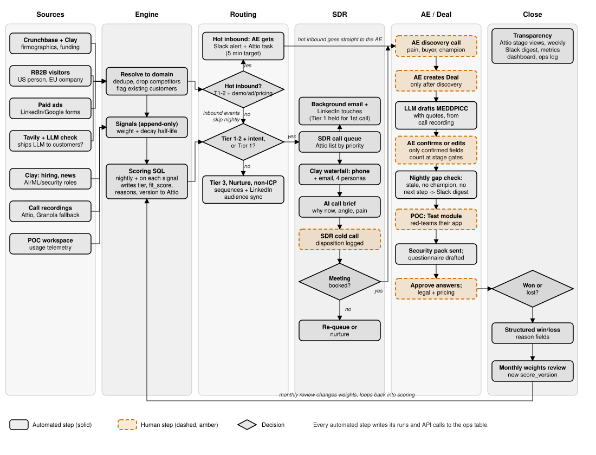

# Part 2: Systems design

Draft. The system acts on the segments and tiers from Part 1 (`mart.org_score`, `mart.org_segment`) and the Attio model in [`../part1-crm-model/crm-data-model.md`](../part1-crm-model/crm-data-model.md). A themed SVG of the same flow is in `docs/dashboard/workflow.svg`.

## (a) Workflow diagram

Rectangles are automated steps. Steps with the `:::human` style are people. Diamonds are decisions.

```mermaid
flowchart LR
  classDef human stroke-dasharray:6 4,stroke-width:2px,fill:#fdebd0,stroke:#d97706,color:#000
  classDef auto fill:#eef2f7,stroke:#475569,color:#000

  subgraph SRC["Sources"]
    S1["Crunchbase + Clay<br/>firmographics, funding"]
    S2["RB2B visitors<br/>US person, EU/UK company only"]
    S3["Paid ads<br/>LinkedIn/Google forms, UTMs"]
    S4["Tavily + LLM check<br/>ships customer-facing LLM?"]
    S5["Clay hiring + news<br/>AI/ML/security roles, funding"]
    S6["Call recordings<br/>Attio, Granola fallback"]
    S7["POC workspace telemetry"]
  end

  subgraph ENG["Scoring engine (this repo's SQL)"]
    E1["Resolve to domain<br/>dedupe, drop competitors,<br/>flag existing customers"]
    E2[("Signals: append-only<br/>weight + decay half-life")]
    E3["Score nightly + on each signal<br/>writes segment, tier, fit_score,<br/>reasons, score_version to Attio"]
  end

  subgraph RTE["Routing"]
    R1{"Hot inbound?<br/>Tier 1-2 + demo / ad form /<br/>pricing or docs visit"}
    R2["Slack alert + Attio task to AE<br/>5 min speed-to-lead"]
    R3{"Tier 1-2 + intent,<br/>or Tier 1?"}
    R4["Tier 3, Nurture, non-ICP<br/>automated sequences +<br/>LinkedIn Matched Audiences sync"]
  end

  subgraph SDR["SDR"]
    D1["Call queue: Attio list<br/>sorted by priority = fit x intent"]
    BG["Background email + LinkedIn<br/>(Tier 1 held until first call)"]
    D2["Clay waterfall: phone + email<br/>CTO, Head of AI, CISO, Compliance"]
    D3["AI call brief<br/>why now, persona angle, likely pain"]
    D4["SDR cold call<br/>disposition logged in Attio"]:::human
    D5{"Meeting booked?"}
    D6["Re-queue or nurture"]
  end

  subgraph AE["AE / Deal"]
    A1["AE discovery call"]:::human
    A2["AE creates Deal<br/>after accepting discovery"]:::human
    A3["LLM drafts MEDDPICC<br/>with supporting quotes"]
    A4["AE confirms or edits<br/>only confirmed fields count"]:::human
    A5["Nightly check: stale field,<br/>no champion, no next step<br/>Slack digest to AE + manager"]
    A6["POC: White Circle Test module<br/>red-teams their app"]:::human
    A7["Security pack auto-sent;<br/>questionnaire answers drafted"]
    A8["Approve answers; legal redlines;<br/>pricing"]:::human
  end

  subgraph CLS["Close"]
    C1{"Won or lost?"}
    C2["Structured win/loss reason"]
    C3["Monthly weight review<br/>new score_version"]
    C4["Weekly Slack digest, Attio stage views,<br/>GTM metrics dashboard, ops table"]
  end

  S1 & S2 & S3 & S4 --> E1
  S5 & S6 & S7 --> E2
  E1 -->|"inbound event, skips nightly"| R1
  E1 --> E2 --> E3
  E3 -->|"tier + priority"| R3
  R1 -->|yes| R2 --> A1
  R1 -->|no| R3
  R3 -->|yes| D1
  R3 -->|no| R4
  D1 --> BG
  D1 --> D2 --> D3 --> D4 --> D5
  D5 -->|yes| A1
  D5 -->|no| D6
  A1 --> A2 --> A3 --> A4 --> A5
  A4 --> A6 --> A7 --> A8 --> C1
  C1 --> C2 --> C3
  C3 -.->|"new weights"| E3
  A5 -.-> C4

  class S1,S2,S3,S4,S5,S6,S7,E1,E2,E3,R2,R4,D1,BG,D2,D3,D6,A3,A5,A7,C2,C3,C4 auto
```

## (b) What I'd build first, what waits, and why

<!-- NOTE-START -->
**Weeks 1-2: scoring in Attio, plus inbound routing.** Part 1's SQL already produces tier, fit score and reasons. I'd write them to Attio Company with a score version, then wire RB2B and ad lead forms to the right AE with a Slack alert, an Attio task and a 5-minute target. This has to be live before ads launch. Ad spend that lands on a form nobody answers for a day is wasted money, and the first weeks of a campaign are the most expensive to waste.

Dedupe on domain belongs in this slice too. Without it, one company arrives three times from three tools and gets three owners.

**Weeks 2-3: the SDR call queue.** An Attio list sorted by priority, a Clay waterfall for the four buyer personas, and an AI call brief: why now, the angle for that persona, the likely pain. SDRs should open the list and dial. Email and LinkedIn run in the background so they never choose a channel.

**Weeks 3-4: signal decay and intent.** Signals get a weight and a half-life, and priority becomes fit times intent. I'd wait until there is a queue to sort, because decay with nobody consuming it is just a nicer-looking number.

**Later, once there is something to learn from:**
- MEDDPICC extraction from calls. There are barely any deals, so there is nothing to calibrate against yet. The rule is already settled: the LLM drafts, the AE confirms, and only confirmed fields count.
- POC telemetry back into Attio.
- Score recalibration from win and loss reasons. Start capturing the reasons as structured fields from day one, though. That costs nothing and the data can't be recreated later.

**Deliberately not building yet:** third-party intent data, multi-touch attribution, forecasting models, expansion. Each needs volume we don't have. RB2B and the ads give us first-party intent already.

**Stays human on purpose:** calls, discovery, champion-building, creating the Deal, confirming MEDDPICC, pricing and legal. Deal creation matters most. If automation creates deals, the forecast fills with ghosts and nobody trusts it.

**One risk to watch.** White Circle is in Paris, so many visitors are EU. RB2B gives only company-level data there, so the person-level route is US-only. Don't promise EU volume from it.
<!-- NOTE-END -->

Word count of section (b), body only, measured with `wc -w`: 370 (cap 500).

## (c) Appendix

### Triggers, actions, owners, SLAs

| Trigger | Action | Owner | SLA |
|---|---|---|---|
| Demo request, ad lead form, or pricing/docs visit from a Tier 1-2 account | Slack alert + Attio task to the account's AE | AE | 5 min target (alert); AE acts or reassigns in 15 min |
| Same, from a non-ICP or Tier 3 account | Add to nurture sequence; no human task | Automation | 1 hour |
| Existing customer visits or fills a form | Alert the account owner, never the SDR | Account owner | Same day |
| Competitor domain visits | Log, suppress, no alert | Automation | n/a |
| New signal on an account | Recompute score; move tier if it changes | Automation | 15 min |
| Nightly run | Rescore all, decay signals, refresh the call queue | Automation | Done by 6am local |
| Tier 1-2 with intent, or Tier 1 without | Add to SDR call queue; run the Clay waterfall; generate brief | Automation then SDR | Brief ready before the first dial |
| SDR books a meeting | Task to AE; account to "Engaged" | SDR | Same day |
| AE accepts discovery | AE creates Deal | AE | Within 1 day of the call |
| Call recording lands on a Deal | LLM drafts MEDDPICC with quotes | Automation | 30 min |
| Deal has a stale field, no champion, or no next step | Slack digest to AE and manager | Automation | Nightly |
| POC workspace created or used | Usage signal written to Attio | Automation | 1 hour |
| Security questionnaire received | LLM drafts answers from the trust center; human approves | AE or SE | Draft in 1 hour; approve in 2 days |
| Deal closed | Won/loss reason required, structured | AE | At close |
| Month end | Review score weights against wins and losses | GTM engineer + RevOps | Monthly |

### Sync-back fields to Attio

| Source | Field | Direction | Overwrite rule |
|---|---|---|---|
| Scoring SQL | `segment`, `tier`, `fit_score`, `reasons`, `score_version` | To Attio | Machine always overwrites. Humans use `tier_override`, never edit `tier` |
| Signal feed | Signal rows (type, weight, half-life, source, timestamp) | To Attio | Append-only; never edited |
| RB2B | Company visit signal; person (US only) | To Attio | Create if new domain; never overwrite an owner |
| Ads | Lead, UTMs, form answers | To Attio | Match on domain first; personal email creates a lead under the matched company or goes to review |
| Clay | Phone, email, persona, hiring and news signals | To Attio | Fill empty fields only |
| Tavily + LLM check | `llm_product_verdict`, evidence URL | To Attio | Overwrites an earlier machine verdict; a human edit wins |
| Dialer or Attio | Call disposition, attempts, next attempt | Both | Human-set, automation reads only |
| Call recording | MEDDPICC draft + quotes | To Attio | Writes to `*_draft` fields only; AE confirmation copies to the live field |
| AE | MEDDPICC confirmed fields, stage, owner, next step | Within Attio | Human only |
| POC workspace | Provisioned, last active, test runs, findings count | To Attio | Machine-owned fields |
| Security pack | Sent date; questionnaire status | To Attio | Machine writes; human sets "approved" |
| Close | `win_loss_reason`, competitor, reason detail | Within Attio | Required at close; human only |
| Ops | Run id, API calls, errors | To ops table | Append-only |

### Automated vs human, and why

| Step | Who | Why |
|---|---|---|
| Data, enrichment, verification, scoring | Automated | Repeatable, and a person adds nothing |
| Routing, briefs, reminders, digests | Automated | Speed and consistency, and nobody should read a spreadsheet to know who to call |
| Background email and LinkedIn | Automated | The brief says SDRs only call |
| MEDDPICC drafts, questionnaire drafts | Automated draft | Saves an hour of typing. A draft is not a fact |
| Cold calls | Human | Calls are the job. Nothing else books meetings from a cold start |
| First personal touch on Tier 1 | Human | These accounts are few. One generic email burns a rare chance |
| Discovery and champion-building | Human | It's trust. A bot can't earn it |
| Creating the Deal | Human | Keeps forecast integrity. Only real opportunities become deals |
| Confirming MEDDPICC | Human | Stage gates must rest on what the AE believes, not on what a model guessed |
| Pricing and negotiation | Human | Judgment, and the founders still own the price floor |
| Legal redlines | Human | Liability |

### Edge cases

| Case | Handling |
|---|---|
| EU/UK visitor on RB2B | Company-level only. Record the account signal, never a person. Outreach goes to personas found through Clay |
| Same company from RB2B, an ad and Clay | Dedupe on normalized domain. One Company, many signals |
| Cold email to EU contacts | Needs a documented lawful basis (legitimate interest assessment), a clear opt-out and a suppression list checked before every send. Check country rules for calls. When unsure, a call or LinkedIn goes first |
| Competitor visitor (e.g. Lakera) | Domain blocklist. Logged, suppressed, no alert |
| Existing customer | Route to the account owner. Never enter the SDR queue |
| Personal email on an ad form | Match by company name and IP, then LinkedIn. If still unmatched it goes to a weekly review list and nurture, not an AE |
| Several leads, one account | One owner per account. New leads attach to the existing owner |
| AE out of office | Calendar flag; route to the named backup, then to the manager after 15 min |
| LLM-drafted field vs human-set | Drafts go to separate `_draft` fields. A human-set value is never overwritten |
| Dead or changed website | Existing gate from Part 1: Tier 3 at most until confirmed |
| Stale score | Every write has `score_version`; never mix versions in one list |

### Metrics to watch

| Metric | Why |
|---|---|
| Speed-to-lead (median, p90) | The thing ads depend on |
| Signal to meeting conversion, by source and tier | Shows which signals deserve weight |
| Stage conversion and time in stage | Where deals stall |
| MEDDPICC completeness, confirmed only | Draft completeness is vanity |
| Share of hot inbound worked in 5 min | The SLA, measured |
| SDR dials and connects per day | Whether the queue is usable |
| Meetings by tier | Whether the tiers predict anything |
| Automation failure rate (from the ops table) | A silent break is the real risk |
| Win rate by segment, and loss reasons | Feeds the monthly recalibration |
